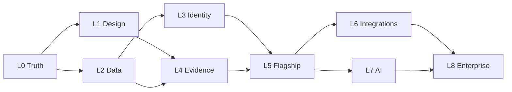

# Loop Graph

The driver prompt `BANKINTELLI_LOOP.md` (installed as `/bankintelli`) reads this file on every tick to decide which loop to work in. `scripts/graph-lint.mjs` runs first inside `npm run gate` and fails when a loop line, a ledger, or the diagram below disagree, or when any citation in these documents stops resolving.

Phases come from `BankIntelli_Elite_Premium_Design_Roadmap.md`; the plan and today's evidence are in `docs/roadmap/BANKINTELLI_ELITE_ROADMAP.md`; shared rules are in `docs/LOOP_CONVENTIONS.md`.

## Three nested loops

1. **Graph loop** (this file): picks the active loop.
2. **Task loop** (one ledger task per tick): failing check first, smallest change, focused test, full gate, local commit, journal.
3. **Verification loop** (each ledger's independent-check task): a different model attacks the work, at least 3 runs, at most 3 rounds of fixes, and a finding counts only as a reproducible failing test or a corrected row.

## Driver rules

1. The active loop is the first unticked loop below whose needs are all ticked.
2. In the active loop's ledger, take the first unticked task whose needs are all ticked and that is not marked (human).
3. If no such task exists in the active loop, try the next unticked loop whose needs are all ticked. If none has an agent task, stop and escalate, naming the (human) tasks that block.
4. Only the human ticks a loop line, after that loop's signoff task is ticked and `npm run gate` passes.
5. A loop's budget is ticks (entries in its Journal) or spend, whichever runs out first. The author picked these defaults; they are not cost estimates. Edit them here.

## Loops

- [x] L0 Truth. ledger: `docs/loops/L0_TRUTH.md` · needs: none. · budget 12 ticks or $15 · `BankIntelli_Elite_Premium_Design_Roadmap.md#Phase 0 --- Baseline and design audit`
- [ ] L1 Design. ledger: `docs/loops/L1_DESIGN.md` · needs: L0. · budget 20 ticks or $20 · `BankIntelli_Elite_Premium_Design_Roadmap.md#Phase 1 --- Design system and shell`
- [ ] L2 Data. ledger: `docs/loops/L2_DATA.md` · needs: L0. · budget 15 ticks or $15 · `BankIntelli_Elite_Premium_Design_Roadmap.md#Phase 2 --- Data boundaries and safe demo mode`
- [ ] L3 Identity. ledger: `docs/loops/L3_IDENTITY.md` · needs: L2. · budget 20 ticks or $25 · `BankIntelli_Elite_Premium_Design_Roadmap.md#Phase 3 --- Identity, authorization and persistence`
- [ ] L4 Evidence. ledger: `docs/loops/L4_EVIDENCE.md` · needs: L1, L2. · budget 15 ticks or $20 · `BankIntelli_Elite_Premium_Design_Roadmap.md#Phase 4 --- Evidence and source registry`
- [ ] L5 Flagship. ledger: `docs/loops/L5_FLAGSHIP.md` · needs: L3, L4. · budget 20 ticks or $25 · `BankIntelli_Elite_Premium_Design_Roadmap.md#Phase 5 --- Complete flagship investigation`
- [ ] L6 Integrations. ledger: `docs/loops/L6_INTEGRATIONS.md` · needs: L5. · budget 15 ticks or $20 · `BankIntelli_Elite_Premium_Design_Roadmap.md#Phase 6 --- Domain integrations`
- [ ] L7 AI. ledger: `docs/loops/L7_AI.md` · needs: L5. · budget 15 ticks or $25 · `BankIntelli_Elite_Premium_Design_Roadmap.md#Phase 7 --- Controlled AI orchestration`
- [ ] L8 Enterprise. ledger: `docs/loops/L8_ENTERPRISE.md` · needs: L6, L7. · budget 15 ticks or $20 · `BankIntelli_Elite_Premium_Design_Roadmap.md#Phase 8 --- Enterprise readiness`

One edge per line below; graph-lint compares these edges with the `needs:` above.

Critical path: L0 → L2 → L3 → L5 → L7 → L8. Ticks are sequential; branches matter because a loop waiting on a (human) task does not block its sibling (driver rule 3), so L1 work fills L2/L3 waits and L6 fills L7 waits.
